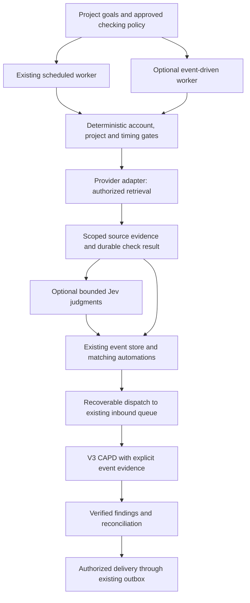

# Optional account integrations and project-directed proactive checks

Status: proposed design and implementation plan; no runtime changes implemented  
Date: 2026-10-30  
Initial providers: Gmail, Microsoft Outlook/Hotmail, Google Calendar, Google Classroom

## Intended outcome

A household member connects an optional account and creates a project with goals
and an explicitly authorized checking schedule. Alphonse finds consequential
information, reconciles it with previous findings, and alerts the right people
with supporting evidence. Connecting an account alone starts no proactive work.

The first example is a project for a child's current school trimester: inspect
authorized mailboxes on Monday mornings for school commitments, identify due
dates and significant assignments, and notify the parent early enough to prepare.
A separate project can look for overdue bills. An overdue notice is evidence of
what the sender reports, not proof that a bill remains unpaid.

Ordinary conversation and one-off authorized account queries remain available
without a project. Proactive checks require a project. Projects can be created
through conversation; users need not manually select one before asking for help.
Use finite efforts such as a trimester or billing period where possible, with
explicit renewal or an explicitly configured ongoing duration.

## Decisions

1. Reuse `EventAutomationStore`, daemon event ingestion, the scheduled worker,
   inbound queue, V3 CAPD, and the existing outbox. Do not create another event bus,
   scheduler, independent reasoning loop, or delivery channel.
2. Ship native optional provider adapters behind a shared account-service API.
   First-party provider support is maintained product code, not generated artifacts.
3. A connection belongs to a household member and may have multiple capabilities.
   Multiple accounts per provider and multiple owners are first-class cases.
4. A project defines goals and proactive-check policy. Account grants are a
   separate enforced record; project membership, config, and skill selection do
   not grant mailbox access.
5. Reuse skills for school coordination and household bills across providers.
   Skills guide interpretation; deterministic services enforce access and timing.
6. Initial delivery is read-only at providers. Sending mail, marking it read,
   archiving, editing calendars, paying bills, and submitting schoolwork require
   separately designed and authorized capabilities.
7. Start with local daemon execution and scheduled polling. Continuous polling
   or provider push requires an explicit event-driven project policy. Hosted
   execution is a later deployment choice, not an implicit dependency.
8. MCP is a possible adapter transport, not the policy or persistence layer.
   A plugin can package optional adapters and skills without requiring an MCP
   server or a general third-party plugin runtime for the first release.

## Existing implementation and verified limits

The following are implementation anchors, not claims that the proposed work exists:

- [Local worker contract](local_event_workers.md): registered same-host workers
  publish structured facts through the owner-only Unix socket.
- [`automations.py`](../alphonse/agent_v2/automations.py): worker/type registration,
  JSON Schema validation, event history, worker/event-ID deduplication, exact
  top-level payload filters, and fan-out into automation execution records.
- [`daemon.py`](../alphonse/agent_v2/daemon.py), `publish_event`: claims executions,
  queues the stored prompt under its owner/project and system memory session,
  attaches `metadata.event`, and records enqueueing.
- [`ipc.py`](../alphonse/agent_v2/ipc.py): event registration/publication methods;
  the socket is mode `0600`. A worker ID is currently a registry lookup, not an
  independently authenticated process identity.
- [`scheduled_worker.py`](../alphonse/agent_v2/services/scheduled_worker.py) and
  [`scheduled_tasks.py`](../alphonse/agent_v2/core/scheduled_tasks.py): durable
  occurrences, leases, retry handling, and queue dispatch to reuse.
- [`channel.py`](../alphonse/agent_v2/core/messages/channel.py) stamps the configured
  intelligence engine. V3 explicitly recognizes event/scheduled sources as
  background work rather than new human admission turns.
- [`context.py`](../alphonse/agent_v2/core/intelligence/v3/context.py) and
  [`projections.py`](../alphonse/agent_v2/core/intelligence/v3/projections.py) do not
  explicitly project `metadata.event` into decision context. Enqueueing a payload
  is not sufficient proof that the model sees it.
- [`integrations/store.py`](../alphonse/agent_v2/integrations/store.py) currently
  persists secret JSON. Response masking is not encryption; new OAuth tokens
  must use a credential backend rather than this field.
- [Project configuration](project-config.md) already defines goals, duration,
  ownership, sharing, and lifecycle; configuration is context, not authorization.

During exploration, all five tests in `tests/test_agent_v2_event_automations.py`
passed. They verify validation, matching, deduplication, IPC, and queue metadata;
they do not establish end-to-end V3 interpretation or restart recovery. In the
adjacent `test_project_provenance_waiting.py` run, the event-routing case passed
and two Home-project-creation expectations failed. Record that baseline separately
when implementing; do not hide those failures or expand this change to repair
unrelated project behavior without investigation.

## Runtime flow



The two edges from evidence describe configurable deterministic-only or
Jev-assisted admission. They must not create two publications for one result.
No-match checks finish with a persisted coverage receipt and normally remain quiet.
CAPD is invoked when interpretation, recovery, or a requested report is needed.

## Connections, grants, and project policies

Introduce explicit persisted records with stable IDs and revisions:

- **Account connection:** provider, provider subject, owner, display address,
  capabilities/scopes granted, credential reference, connection status, and health.
  Use statuses such as `connected`, `paused`, `reauth_required`, and `disconnected`.
  Do not reuse messaging addresses as account ownership or select an account by
  `get_by_provider`, which returns only one current record.
- **Account grant:** grantor, connection, beneficiary/executing principal, project
  when applicable, allowed read operations and resource constraints, expiry,
  revision, and revocation state. Only an authorized owner/grant manager can
  expand it. Consent in Google/Microsoft and an Alphonse grant are separate layers.
- **Project check policy:** project and executing owner, goal snapshot/digest,
  connection/grant references, bounded source query, skill hints, trigger mode,
  schedule/timezone, retrieval window, lookback, catch-up behavior, resource/model
  budgets, recipients, finding-sharing scope, and status. The default is disabled.
- **Check run:** policy revision, occurrence identity, effective grants, source
  coverage, page/cursor progress, timestamps, outcome, and publication identity.
  Distinguish complete, partial, no-match, blocked, failed, and cancelled outcomes.
- **Source evidence:** connection/owner scope, provider resource ID and version,
  observed and source timestamps, safe source link, authorized content reference,
  retention deadline, and deletion/tombstone state.
- **Finding:** project/goal association, evidence references, bounded audience,
  extracted facts and uncertainty, due date/timezone when known, state, related
  finding IDs, and notification history. It is not a provider event or a task result.

Store operational authority in the shared database through validated services.
`project_config.json` remains editable goal/duration context; it may display
policy references, but editing a file cannot activate monitoring or expand grants.
Changing relevant goals marks the policy `needs_review` and suspends new checks
until the user authorizes the revised scope. Conversation can create or revise
policies when the user's instruction is sufficiently explicit; routine execution
within the existing policy needs no repeated approval.

An illustrative policy projection returned to the owner (not an authorization
document, and not the existing project-config schema):

```json
{
  "policy_id": "check_school_trimester",
  "revision": 1,
  "project_id": "project_school_trimester",
  "goal_snapshot": "Catch upcoming school commitments early enough to prepare",
  "connection_ids": ["connection_parent_gmail"],
  "grant_ids": ["grant_parent_school_read"],
  "trigger": {
    "kind": "schedule",
    "weekdays": ["MO"],
    "local_time": "08:00",
    "timezone": "America/Mexico_City"
  },
  "retrieval_window": {
    "weekdays": ["MO"],
    "start": "08:00",
    "end": "09:00"
  },
  "missed_run": "next_allowed_window",
  "initial_lookback_days": 30,
  "notification_mode": "material_changes",
  "recipient_user_ids": ["parent"],
  "status": "active"
}
```

The actual API validates recipient IDs, grants, project access, and duration before
producing this projection. User interfaces show natural-language schedules; the
existing scheduler remains responsible for recurrence calculation.

### Timing and lifecycle semantics

“Check email only on Mondays” restricts provider content retrieval and background
analysis, not just alert delivery. Offer a clear time/window when creating the
policy. Every background fetch, pagination step, attachment read, retry, and
continuation rechecks its occurrence window. Stop at the boundary and persist
partial coverage; never silently continue on Tuesday.

Default missed-run behavior is the next allowed window, with a gap notice in the
status UI. A user can explicitly authorize a bounded late catch-up policy. Use
timezone-aware recurrence and test daylight-saving transitions. Authentication
maintenance is distinct from reading mail; reconnect requires user interaction
when provider consent has expired or been revoked.

Initial history is bounded and visible. Subsequent checks cover changes since
the last successfully covered position, even if a message's deadline is much
later. Query changes require a new baseline or an explicit overlap/backfill;
never reuse a cursor from a different query/folder/scope. A user-requested one-off
query is separately authorized work and does not alter the background policy.

Project pause/end/completion/archive suspends new retrieval and invalidates
queued background work. Recheck at dispatch, provider call, CAPD entry, and
delivery. Cancellation stops subsequent calls and suppresses delivery; it cannot
recall bytes already returned by an in-flight read. Resume does not replay every
missed occurrence or revive stale policy revisions. Connection pause/revocation
blocks dependent policies without changing unrelated projects or accounts.

Sharing a project never shares its connected accounts. Recipients can receive
explicitly authorized derived findings without receiving raw-message access.
Changing project members cannot expand an existing finding's audience.

## Event framework changes

### 1. Bind events to trusted scope

Add a versioned server-owned envelope with publication ID, worker identity,
owner, connection/grant or household-resource binding, project policy/revision,
check-run ID, event type/version, and occurrence/observation timestamps. Bind
these fields from trusted registration and the active authorized run. Payload
claims about ownership or grants never establish access.

Match subscriptions only within authorized scope before applying existing exact
payload filters. Recheck grants and active project/policy status at dispatch and
evidence expansion. Catalog/history/status IPC must filter by authenticated actor;
the current unscoped automation catalog must not expose private mail metadata.

Initially run native adapters under daemon control. The owner-only socket is a
same-OS-user trust boundary, not per-worker authentication or a sandbox. Before
supporting independent limited workers, provide a restricted publication endpoint
with daemon-issued, revocable worker credentials bound to permitted resources and
event types; it must not offer registration or general daemon methods. Same-user
malicious host processes remain outside this isolation guarantee.

Use events such as `account.check_candidates_ready` or
`account.check_attention_required`. Keep the prompt fixed in the approved
automation. Publish bounded references and check coverage rather than full
mailboxes, OAuth tokens, or model-authored instructions. A claimed probability
is advisory metadata, never a fact about a deadline or successful operation.

### 2. Make dispatch recoverable

Extend existing automation executions with atomic claiming, lease owner/expiry,
attempt count, next retry time, policy revision, stable queue ID, terminal state,
and redacted failure code. Reuse the scheduled-worker lease/backoff conventions.
A daemon dispatch tick drains pending work and recovers expired claims even when
no new event arrives; `publish_event` can wake that dispatcher rather than own
the only drain loop. Do not hold a database transaction across network/model work.

Use an idempotent enqueue keyed by execution ID. Test a crash after queue insertion
but before marking enqueued: recovery must reconnect to the original message,
not create a second CAPD task. Track queued, processing, completed, cancelled,
and failed outcomes separately; acceptance/enqueueing is not successful analysis
or successful notification. Outbox delivery gets its own stable idempotency key
and recipient-level outcome; document any provider channel that cannot guarantee
duplicate suppression after an ambiguous send.

### 3. Separate retention from deduplication

Keep deduplication receipts independently of payload history. Today deduplication
depends on a history row that pruning can delete. Retain receipt/tombstone IDs for
the supported replay horizon and reject expired replays; avoid a claim of eternal
exactly-once processing. Never prune evidence or events required by pending,
leased, retryable, or active executions. Preserve required evidence until those
runs finish, subject to revocation/deletion rules that invalidate access.

Separate publication deduplication, policy/check-run deduplication, provider
resource-version deduplication, finding reconciliation, and notification
deduplication. One source event may legitimately serve two authorized projects.
Repeated unrelated wording must not merge distinct assignments or invoices.

### 4. Project event evidence into V3 explicitly

Create a shared bounded renderer for triggering evidence, used by the legacy V3
context path and the projection path. Include source IDs, coverage/freshness,
scope-checked source excerpts, and uncertainty for curation, planning, tactical
execution, and review as needed. Extend input manifests/receipts so tests can
prove which evidence reached each decision.

Authenticate and validate references before loading. Mark provider text and
attachments as external untrusted data, separate from the stored prompt and
runtime constraints. Subject lines, quoted messages, calendar descriptions, and
attachments cannot grant permissions, change recipients, or activate skills/tools.
Source expansion rechecks access and timing. Oversized evidence uses bounded
pagination or explicit partial status; truncation cannot become “nothing found.”

## Provider adapter contract

Expose common operations for capabilities/health, bounded search/list, source
read, permitted attachment read, and change iteration. Each call requires an
execution context with authenticated actor, connection, grant, optional active
project policy/occurrence, deadline, cancellation, and budget. No implicit account.
Ad hoc reads use the same service with their own authenticated task scope.

Adapters preserve provider IDs, timestamps, versions, and provenance. Normalize
transport/MIME/HTML deterministically; do not remove quoted evidence needed for
interpretation or execute scripts/remote images. Fetch attachments only when
allowed and needed, with size/type limits and existing authorized asset handling.
Links in messages do not authorize arbitrary browsing or credential forwarding.

Provider-specific cursors remain opaque. Persist accepted page results and their
replay identities durably before advancing progress. Track acquisition separately
from classification/analysis so a model failure cannot make a message disappear
behind a committed cursor. An expired cursor causes an explicitly bounded resync
and overlap deduplication, with a visible coverage gap if completeness is unknown.
Provider errors, throttling, inaccessible folders, and missing attachments produce
partial/blocked/failed results rather than a clean no-match.

- **Gmail:** initial bounded retrieval and incremental mailbox history; recover
  from expired history IDs. Use `gmail.readonly`; do not request send/modify scopes.
  See [scopes](https://developers.google.com/workspace/gmail/api/auth/scopes) and
  [synchronization](https://developers.google.com/workspace/gmail/api/guides/sync).
- **Outlook/Hotmail:** Microsoft Graph with delegated `Mail.Read` for personal
  Outlook.com/Hotmail and eligible work/school accounts. Delta is folder-scoped;
  persist folder coverage and continuation/delta links separately. An Inbox-only
  baseline must not claim to cover school messages moved by rules. See
  [mail permissions](https://learn.microsoft.com/en-us/graph/api/user-list-messages?view=graph-rest-1.0)
  and [message delta](https://learn.microsoft.com/en-us/graph/api/message-delta?view=graph-rest-1.0).
- **Google Calendar:** separately consented calendar discovery and event reading
  for selected calendars. Preserve recurring-instance identity, exceptions,
  cancellations, all-day dates, and timezones. Calendar presence is context, not
  proof an assignment is done. See [scopes](https://developers.google.com/workspace/calendar/api/auth)
  and [incremental sync](https://developers.google.com/workspace/calendar/api/guides/sync).
- **Google Classroom:** validate account/course role and school restrictions.
  Use only necessary read scopes for course discovery, coursework and explicitly
  needed submission/announcement metadata. A parent's guardian relationship must
  not be interpreted as student API access. Guardian summary mail can be handled
  by the email adapters. Preserve missing due dates and missing grading weights;
  never infer the “30%” example from points alone. See
  [roles](https://developers.google.com/workspace/classroom/guides/key-concepts/user-types)
  and [coursework listing](https://developers.google.com/workspace/classroom/reference/rest/v1/courses.courseWork/list).

Optional dependencies load only for enabled providers. Missing configuration or
an SDK cannot prevent daemon startup or unrelated integrations from working.
Future MCP adapters must meet this same scope, provenance, error, cancellation,
and timing contract; opaque tools without those guarantees are insufficient.

## OAuth and data handling

Use provider-supported OAuth authorization-code flows with PKCE/state, exact
registered callbacks, expiry checking, and established client libraries. Use a
system browser and a supported local callback for the local deployment; a desktop
public client must not rely on a bundled client secret. Request provider-supported
offline access as needed. Handle refresh rotation/concurrency and reauthorization
without exposing credentials to models, skills, project folders, IPC responses,
event history, logs, or generic tool arguments.

Implement an OS credential-store backend for desktop installations. Headless hosts
need an explicitly configured encrypted credential backend with a separately
protected key; no plaintext fallback. Account metadata stores only references.
Disconnect invalidates grants, stops work, clears tokens/local caches according
to the declared policy, and attempts provider revocation where supported. If
offline, report local disconnection and remaining provider-side revocation work.
Do not migrate existing Telegram/Discord secrets as an unrelated prerequisite.

Google marks Gmail read access restricted. Public distribution must complete
the applicable verification; transmitting/storing restricted data can require
a security assessment. Remote Jev and System Two processing counts as data
leaving the host and must be included in the deployment review. Explain enabled
processors to the user and evaluate retention/training terms before rollout.
See [restricted-scope verification](https://developers.google.com/identity/protocols/oauth2/production-readiness/restricted-scope-verification)
and [Workspace data-use policy](https://developers.google.com/workspace/workspace-api-user-data-developer-policy).

Separate short-lived source caches, operational receipts, and user-authorized
durable findings. Specify allowed retention/deletion for each under provider
requirements; do not copy whole mailboxes into the Memory Ledger. Derived findings
retain source/audience restrictions and correction/deletion behavior. A deleted
or revoked source cannot remain secretly readable from a prompt cache, checkpoint,
export, or memory entry. Restrict stored excerpts and scrub/redact or invalidate
dependent views under the applicable retention policy.

## System One, System Two, and findings

Use reviewed bounded questions with Noul/Choice/Score for message relevance,
presence of an actionable commitment, evidence of a material change, and urgency
relative to explicit project criteria. Run independent questions in parallel on
bounded authorized content. Record question/model version, probabilities, and
source IDs without recording private content in telemetry.

Jev does not extract free-form assignment descriptions, invent dates, compose
prompts/tool calls, authorize recipients, or declare provider effects successful.
System Two performs open-ended interpretation, structured extraction when needed,
reconciliation, planning, and user-facing language. Skills provide reusable
expertise without containing account credentials or personal grants. Follow
[System One boundaries](v3-hierarchical-capd/06-system-one-check-act.md) and
[progressive reveal](v3-hierarchical-capd/03-progressive-tool-revealing.md).

Deterministic filters can publish directly when they establish relevance. When
Jev is ambiguous, defer to bounded CAPD interpretation within policy. When Jev
fails, retain the candidate as pending/degraded for retry or CAPD interpretation;
do not mark it irrelevant, bypass required V3 System One checks, or silently
replace all bounded classification with a high-volume LLM scan. Saturated budgets
produce partial coverage and a visible pending count.

Findings distinguish reported statements from verified outcomes. Reconcile a
deadline correction against the prior finding and notify once about the material
change; an older quoted email must not overwrite the latest authoritative notice.
Ambiguous child/assignment identity remains unresolved. Overdue-bill notices are
not payment verification. No-match notification is quiet by default; user-requested
digests may include a truthful coverage summary. Important findings include the
source, date, why they meet the project goal, and remaining uncertainty.

Provider-native read tools receive stable native IDs and capabilities such as
`mail_read`, `calendar_read`, and `classroom_read`, reviewed Jev questions, and
deterministic service checks before exposure and again on execution. Account IDs
are runtime resources, not one registered tool per account. Registry changes
follow the existing restart/versioning contract. No artifact IDs enter curation.

## User surfaces and operational visibility

Desktop and TUI expose the same service contracts:

- Connections: add account, capability consent, owner, health, pause, reconnect,
  disconnect, and explicit account grants. No credentials returned after entry.
- Project checks: goals, source accounts/resources, natural-language schedule,
  retrieval window, initial lookback, duration, skills, recipients, activate/pause,
  last/next run, coverage, and pending authorization or reconnect needs.
- Work/automation views: check runs, partial failures, missed windows, candidate
  counts, CAPD handoff, findings, notification delivery, and retry/cancellation.
- Conversation: configure and revise these through authorized native management
  capabilities; display a concrete policy summary and resolve missing information
  before activation. Do not require users to enter RRULEs or provider scope strings.

Healthy no-change runs stay quiet. Notify on requested findings, meaningful
corrections, persistent failures, or required action. Metrics include checks/pages,
coverage, candidate counts, model calls, handoff latency, retries, delivery outcome,
and suppressed duplicates; logs exclude message bodies, subjects, tokens, and
attachment names. Sleeping/offline hosts show stale status and apply the selected
missed-run policy; they cannot promise continuous coverage.

## Implementation sequence and acceptance gates

Each stage is a reviewable change with disposable fixtures. No household-account
read is needed for unit/integration tests. Complete prerequisite gates before
enabling private-data pilot use; this document is not authorization to connect
or read any real account.

### Stage 1 — Strengthen the shared event framework

- [ ] Add scoped envelope/worker bindings and actor-filtered catalog/history APIs.
- [ ] Add execution leases, recovery tick, idempotent queue insertion, lifecycle
  callbacks, independent replay receipts, and safe history retention.
- [ ] Add explicit bounded event-evidence context and manifests for both V3 paths.
- [ ] Preserve existing sensor event schemas and fixed-prompt subscriptions.
  Legacy unscoped workers can continue only for their existing trusted local
  use; private account event types require scoped registration. Require explicit
  reconciliation for ambiguous scope rather than guessing owners.

Primary files: `automations.py`, `daemon.py`, `ipc.py`, `runtime.py`, queue/storage
interfaces, V3 `context.py`/`projections.py`, and retention/migration code. Add a
small dispatch service under `services/` rather than a second event subsystem.

Gate: existing event tests plus cross-owner denial, spoofed scope, disabled
subscription, concurrent claim, crash at each handoff, duplicate after pruning,
pending-history preservation, bounded backlog, cancellation, and exact evidence
receipt tests. A synthetic sensor event must reach the selected V3 engine with
its evidence visible and no duplicate task after restart.

### Stage 2 — Account connections and credential boundary

- [ ] Add provider capabilities, connection/grant stores, credential-backend API,
  account service authorization, health, OAuth lifecycle, and redacted IPC.
- [ ] Implement native optional provider registration without changing messaging
  channel routing or making providers mandatory at startup.
- [ ] Add connection/grant management in Desktop and TUI.

Primary areas: `integrations/`, `daemon.py`, `ipc.py`, runtime wiring, Desktop
settings, and TUI integrations. New modules should separate accounts/credentials
from existing message-channel configuration.

Gate: two owners/two accounts of one provider, grant narrowing/revocation,
scope denial, account-selection ambiguity, OAuth state/PKCE errors, refresh races,
missing secure store, reconnect, disconnect during a run, and absence of secrets
from logs, persisted project files, IPC, and inference requests.

### Stage 3 — Project policies and scheduled acquisition

- [ ] Add validated policies/check runs and lifecycle guards with revision fencing.
- [ ] Extend existing scheduled dispatch with a typed deterministic `project_check`
  job handler, rather than using an LLM merely to poll an account. Preserve
  `direct` reminder and `pdca` modes. Provider fetches run outside scheduler ticks
  with bounded concurrency and durable claims.
- [ ] Persist acquisition progress and publish scoped results into the hardened
  event mechanism. Add truthful no-match/partial completion and quiet status.
- [ ] Add project configuration flow and versioned APIs shared by all clients.

Primary areas: project services/stores, `core/scheduled_tasks.py`,
`services/scheduled_worker.py`, the new acquisition service, daemon/IPC,
`desktop/src/`, and TUI. Update `docs/project-config.md` to distinguish project
intent from authorized operational policies.

Gate: Monday-only zero off-window reads (including retries/attachments), timezone
transitions, missed runs, overlap, pagination, changed queries, stale revisions,
end dates, goal edits, pause/archive/completion, revoked grants, and two projects
using one account without duplicating delivery or bypassing either policy.

### Stage 4 — Gmail and the first vertical slice

- [ ] Implement Gmail read adapter, opaque history handling, bounded initial scan,
  MIME normalization, source expansion, and permitted attachment reads.
- [ ] Add reviewed System One questions and native read-tool reveal/execution gates.
- [ ] Add provider-independent school-coordination skill, findings reconciliation,
  audience-scoped persistence, and idempotent outbox notifications.

Gate: synthetic buried assignment notice saying “30%”, irrelevant newsletter,
missing due date, corrected deadline, quoted old notice, ambiguous child,
duplicate notice, attachment-only deadline, expired history, revoked source,
malicious email instructions, Jev ambiguity/outage, and a no-match run. Assert
source-backed output, one material-change alert, visible coverage, and no writes
to Gmail. Run an explicitly consented local read-only pilot after provider and
processor prerequisites pass.

### Stage 5 — Outlook/Hotmail and provider interchangeability

- [ ] Implement delegated Graph mail access, folder coverage, delta recovery,
  provider IDs, rate limits, and account health.
- [ ] Add bills workflow using the same policy/evidence/finding services.

Gate: shared conformance fixtures for both mail adapters; personal and eligible
work/school account flows; school mail moved outside Inbox; expired delta token;
partial folder access; 429/backoff; immutable-source mapping where needed; and
overdue notice followed by payment/correction evidence. Skills must not require
provider-specific mailbox syntax.

### Stage 6 — Google Calendar and Classroom

- [ ] Implement Calendar read context with explicit selected calendars and sync.
- [ ] Implement Classroom read access only for validated account/course roles,
  with precise unavailable/permission-denied states.
- [ ] Reconcile cross-source evidence without treating missing access as absence.

Gate: recurring calendar exceptions/cancellations, all-day/timezone semantics,
expired sync token, calendar permission changes, guardian-only denial, permitted
student/course access, school-admin restriction, unknown submission status, and
grade weight absent from coursework. Cross-source duplicates yield one finding
while preserving separate supporting evidence and audiences.

### Stage 7 — Release and optional event-driven operation

- [ ] Complete provider verification, processor/retention review, install guidance,
  migration rehearsal, observability, and permission-focused client acceptance.
- [ ] Add explicitly authorized continuous polling/provider push if needed,
  through existing scoped publication and dispatch; enforce policy windows and
  validate provider notifications. Push is a hint to retrieve permitted changes,
  never trusted assignment content or permission to read.
- [ ] Evaluate MCP transport only against adapter conformance and operational
  needs. Generic plugin installation and hosted infrastructure are separate work.

Gate: restart/offline/catch-up exercises, household account separation,
revocation/deletion propagation, notification delivery ambiguity, feature-disabled
startup, staged opt-in, and rollback without losing existing sensor automations.

## Migration, rollout, and remaining decisions

Use additive/versioned schema migrations and feature flags disabled by default.
Preserve worker, event, automation, project, schedule, and account identities;
never infer account grants from old payloads or project sharing. Migrate trusted
legacy sensor records explicitly without silently sharing their history. Existing
scheduled prompts remain valid; typed acquisition jobs are new records. Disabling
account checks stops dispatch and retrieval while leaving existing tools and
channels usable. Before downgrading binaries, stop new job kinds and document
the supported database compatibility path.

The first deliverable is Stages 1–4: one local, project-scoped weekly school-mail
review through Gmail, with the adapter interface and tests prepared for Outlook.
Ship Outlook before describing the experience as provider-independent in release
materials. Calendar and Classroom add context after the mail path is reliable.

Resolve these before the relevant implementation stage; the recommended local
defaults above allow framework work to start:

- Supported headless credential backends and OS support (Stage 2).
- Exact provider registrations, production OAuth publication model, and permitted
  inference-provider data terms (before real-account pilot/public release).
- Default evidence/finding retention, replay horizon, and redaction of existing
  checkpoints/exports (Stages 1–2, before private data persists).
- Numeric Jev thresholds, batch/page/model budgets, retry limits, and overload
  policy, calibrated on held-out synthetic school/bill cases before Stage 4 pilot.
- Whether users need continuous observation or hosted availability after the
  scheduled local experience is validated (Stage 7).

Success means detecting a consequential notice within the authorized checking
window, explaining its significance with evidence, preserving uncertainty,
recognizing corrections, delivering only to permitted people, and recovering
from interruptions without losing work or repeatedly notifying the household.
